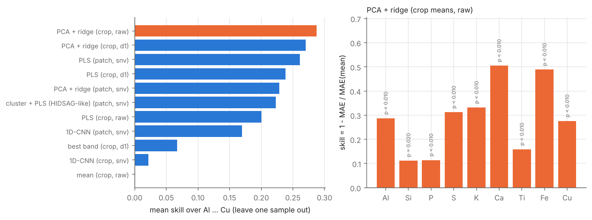
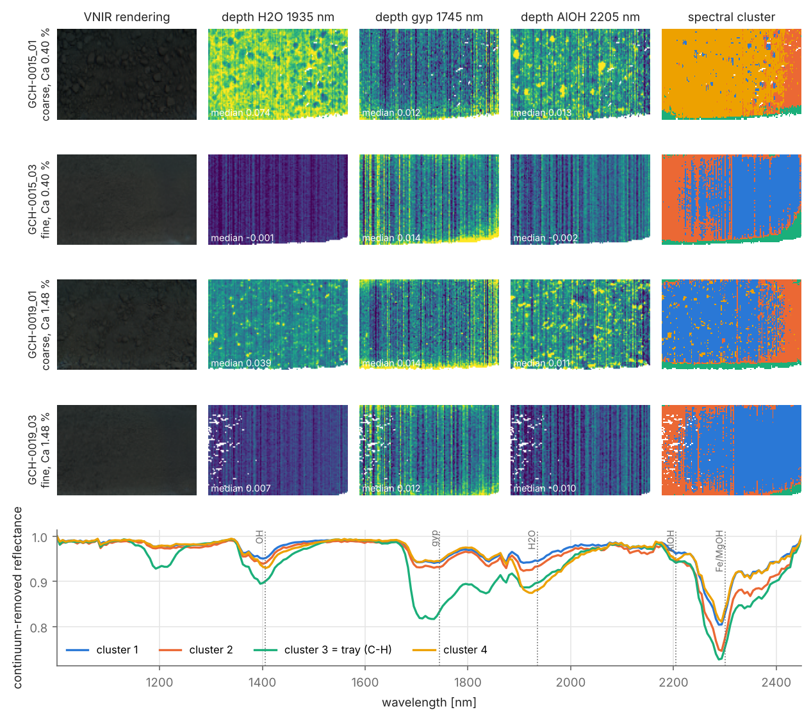

# Ore geochemistry from hyperspectral images: an honest baseline on HIDSAG

Can a hyperspectral camera above a conveyor belt tell the chemical composition of the ore that feeds a SAG
mill? This repository answers the question for the public **HIDSAG GEOCHEM** data set
(28 samples of porphyry copper ore, VNIR + SWIR images, 18 elements by pXRF), with a validation that a mine
could trust: every number is measured on samples the model has never seen.

It is the cleaned-up version of a project for the course *Machine Vision* (M.Sc. Optimization, HSBI).
The course notebook trained a CNN on 28 mean spectra and evaluated it on random splits; this version uses the
image data properly, explains what the spectra can physically see, and measures how much of the published
accuracy survives an honest split. The executive report is [`report/report.pdf`](report/report.pdf).

## Findings

| | |
|---|---|
| **Honest skill** | Leave-one-sample-out, the best model (PCA + ridge on crop-mean spectra) reduces the error of the mean predictor by **29 %** on average over the nine major elements: Ca −50 %, Fe −49 %, K −33 %, S −31 %, Al −29 %, Cu −28 %. Si, P and Ti are barely predictable. |
| **Simple beats deep** | A small 1D-CNN barely beats the mean predictor on crop means (skill +0.02) and reaches +0.17 on pixel patches; PLS and PCA + ridge are the right tools for 28 labelled samples. |
| **Leakage** | All crops and pixels of a sample share one label. The same PLS model scores a skill of 0.46 with random patch splits, 0.39 leaving one crop out and 0.26 leaving one sample out: a leaky split lets the model recognise the sample instead of predicting its chemistry. |
| **Published numbers** | The MAPE of 0.02 % for Al reported for GEOCHEM in the HIDSAG paper is two orders of magnitude below anything a sample-wise validation gives (3.1 %; the mean predictor already gives 4.5 %). |
| **What the camera sees** | Minerals, not elements: Al and K follow the Al-OH band of muscovite at 2205 nm, Ca the molecular-water band at 1935 nm. Cu has no absorption of its own and is predicted through the alteration minerals that accompany it. |
| **Artefacts** | Grain size changes the absorption depths more than composition does (coarse crops absorb more than fine crops of the same sample by 3.5x the sample-to-sample spread), and up to 16 % of a crop's pixels are the plastic tray. Neither correction improves the model, which is a useful negative result. |





## Repository

```
src/hsgeo/          data loading (crop / patch level), pre-processing, band depths, models, validation, maps, plots
scripts/            one script per table / figure of the report
data/               crop-mean spectra (96 kB) and labels: enough to reproduce the crop-level results
results/            CSV output of the scripts
figures/            PNG (README) + PDF (report)
report/             LaTeX source of the report (make)
tests/              pytest
```

## Reproduce

```bash
pip install -r requirements.txt
pytest -q

# crop level: runs from the files in data/ (no download needed)
python scripts/spectral_analysis.py       # spectra, correlation spectrum, grain-size variance   (~20 s)
python scripts/run_benchmark.py           # leave-one-sample-out benchmark                       (~3 min)
python scripts/permutation_test.py --n 100  # p-values of the skill                               (~1 h)
python scripts/make_figures.py
```

The patch-level experiments, the leakage study, the robustness checks and the mineral maps need pixel data.
Download the GEOCHEM record (`GCH.zip`, ~7 GB) from Figshare
([doi:10.6084/m9.figshare.c.5983921](https://doi.org/10.6084/m9.figshare.c.5983921.v1)), unzip it and
reduce it to 170 MB of per-crop extracts (crop means + 1000 random pixels per crop):

```bash
python scripts/extract_hidsag.py <path>/GEOCHEM data/extract GCH-0001 GCH-0002 ...   # all 28 samples, ~15 s
mkdir -p data/raw && cp -r <path>/GEOCHEM/GCH-0015 <path>/GEOCHEM/GCH-0019 data/raw/   # for the maps (crops 01, 03)

python scripts/run_benchmark.py --patch   # patch level                                           (~15 min)
python scripts/leakage_study.py           # random vs crop-wise vs sample-wise splits             (~25 min)
python scripts/robustness.py              # grain size, size fractions, tray masking              (~3 min)
python scripts/mineral_maps.py            # band-depth and cluster maps                           (~30 s)
cd report && make                         # tables from results/ and the PDF
```

Times are for a 2-core cloud VM.

## Data and licence

HIDSAG: A. Ehrenfeld et al., *HIDSAG: Hyperspectral Image Database for Supervised Analysis in Geometallurgy*,
Scientific Data 10, 164 (2023), [doi:10.1038/s41597-023-02061-x](https://doi.org/10.1038/s41597-023-02061-x);
data on Figshare under CC BY 4.0. The files in `data/` are derived from the GEOCHEM record (crop-mean spectra,
pXRF labels, wavelengths) and are redistributed under the same licence.
